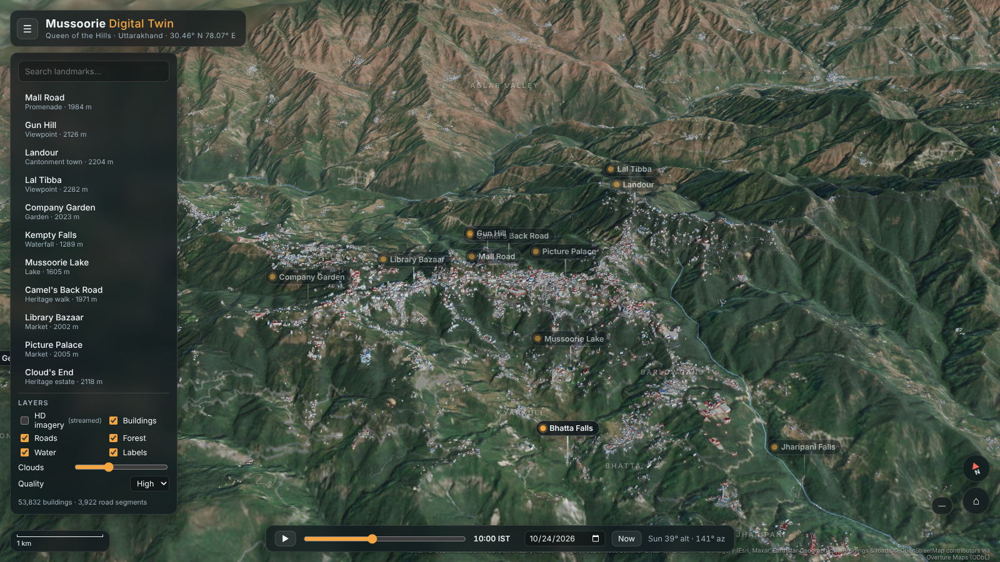
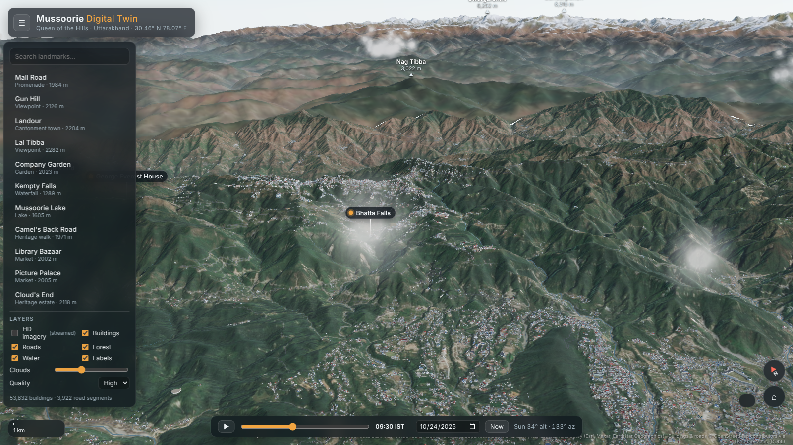
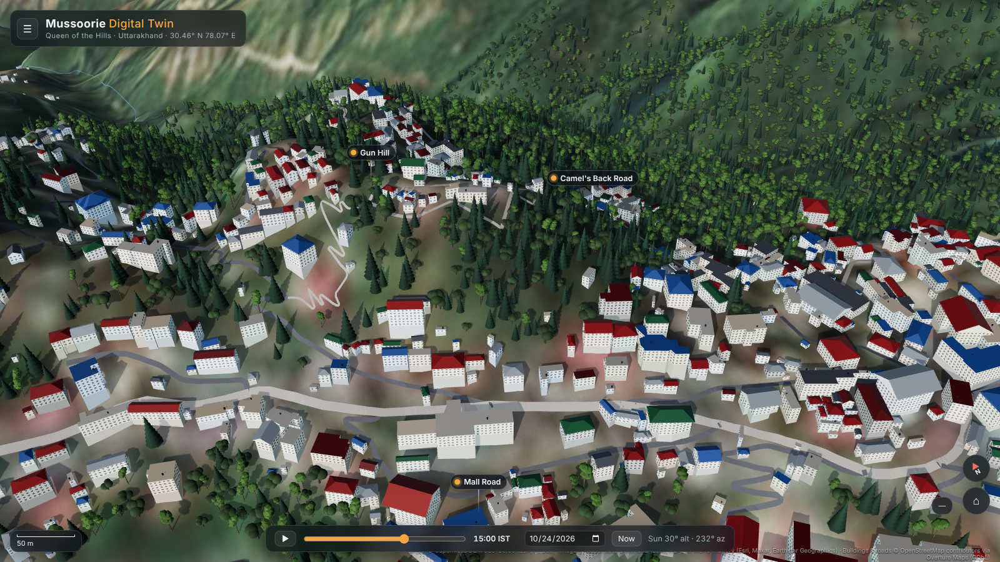

# Mussoorie Digital Twin

An interactive, browser-based 3D model of **Mussoorie, Uttarakhand** and its surroundings, built
entirely from open geospatial data and rendered with Three.js. It covers the town, Landour,
Kempty, the Dehradun road and the ridge road to Dhanaulti (about 31 × 19 km at 30 m detail),
framed by a 190 × 145 km far field that reaches the Doon Valley and the snow peaks of the
Garhwal Himalaya.



| Looking north to the Greater Himalaya | Mall Road, Kulri and Gun Hill at 3 pm |
| --- | --- |
|  |  |

## Run it

The app is a static site with no build step and no external runtime dependencies (Three.js is
vendored). Serve the `public/` folder over HTTP:

```bash
cd public
python3 -m http.server 8000
# open http://localhost:8000
```

Any static host (GitHub Pages, Netlify, S3…) works the same way. Deep links select a landmark,
for example `http://localhost:8000/#lal-tibba`.

### Controls

| Action | Mouse / touch | Keys |
| --- | --- | --- |
| Pan | left-drag / one finger | arrow keys |
| Rotate and tilt | right-drag / two fingers | |
| Zoom (toward cursor) | wheel / pinch | |
| Fly in | double-click the terrain | |
| Coordinates and elevation | hover; click for a summary | |
| Landmark | click a label or a list entry: the camera flies there and the route is highlighted | |

The bottom bar sets the **date and time (IST)**. The sun follows a solar ephemeris for
Mussoorie, so shadows, sky colour, haze and night-time window lights all follow the real sun.
**▶** plays a day-long time-lapse.

## What is real and where it comes from

| Layer | Source | Notes |
| --- | --- | --- |
| Terrain (detail) | Copernicus GLO-30 DSM (ESA / Airbus), 1″ ≈ 30 m | `tools/fetch_dem.py`. This is a surface model, so it includes forest canopy height. |
| Terrain (far field) | Copernicus GLO-90 DSM, resampled to 0.0025° | `tools/fetch_far_dem.py`. Reaches Bandarpunch, Swargarohini and the Kedarnath group. |
| Imagery (detail) | Sentinel-2 L2A 10 m: per-pixel median of five cloud-free scenes, Oct–Nov 2025 (tile 44RKU) | `tools/fetch_imagery.py`. Topographic C-correction removes most of the baked-in slope shading so the scene can be re-lit. |
| Imagery (far field) | Sentinel-2 L2A 80 m overviews from 17 scenes over six MGRS tiles | `tools/fetch_far_imagery.py` |
| HD imagery (optional) | Esri World Imagery, streamed at zoom 16–18 around the view | Turns itself off if the network blocks it. |
| Buildings (53,832) | OpenStreetMap + ML footprints via Overture Maps (release 2026-10-21) | `tools/fetch_overture.py`, `tools/build_vectors.py` |
| Roads (3,922 segments), streams, Mussoorie Lake | OpenStreetMap via Overture Maps | Named roads such as Mall Road, Camels Back Road, Tehri Rd and Mussoori-Chamba Road are used for route highlighting. |
| Forest placement | Sentinel-2 NDVI with buildings and roads masked out | Species follow altitudinal zonation: sal below 1,000 m, chir pine on mid slopes, banj oak and deodar on the upper ridges. |
| Landmark positions | OpenStreetMap / Overture POIs, checked against the DEM | Peak labels snap to the DEM summit. |

Scene coordinates are metres on a local tangent plane centred at 30.455° N, 78.100° E. Earth
curvature (with standard refraction) is applied, which matters for the 100 km sight lines to
the high Himalaya.

### Modelled rather than measured

- **Building heights.** Fewer than 0.2% of footprints have a recorded height or floor count.
  The rest are estimated from footprint area (1–2 floors for village houses, 2–4 for town
  blocks, 3–6 for large hotels). Walls extend down to the lowest ground point under each
  footprint, the way hillside buildings step down the slope.
- **Roof shapes and colours.** Rectangular footprints get hipped or gabled tin roofs. Colours
  are read from the satellite pixel where the roof is large enough to resolve, and otherwise
  drawn from the local palette (red oxide, green, grey and blue tin). Other footprints get
  flat concrete roofs with water tanks.
- **Individual trees** are procedural. Their density and location come from NDVI, but each
  tree's exact position and species are not mapped.
- **Clouds** are illustrative. Their shadows on the ground are consistent with the cloud
  positions and the sun direction.

## Rebuilding the data

```bash
python3 -m venv .venv && . .venv/bin/activate
pip install numpy scipy rasterio pyarrow fsspec aiohttp requests shapely pillow
cd tools
python fetch_dem.py ../public/data
python fetch_far_dem.py ../public/data
for t in "theme=buildings/type=building buildings.parquet id,geometry,height,num_floors,class,names,roof_shape" \
         "theme=transportation/type=segment roads.parquet id,geometry,class,subtype,names,road_surface" \
         "theme=base/type=water water.parquet id,geometry,class,subtype,names"; do
  set -- $t; python fetch_overture.py $1 ../build/$2 $3; done
python fetch_imagery.py ../public/data ../build/ndvi.png
python fetch_far_imagery.py ../public/data
python build_vectors.py ../build ../public/data
```

All sources are anonymous, public AWS buckets: `copernicus-dem-30m`, `copernicus-dem-90m`,
`sentinel-cogs` and `overturemaps-us-west-2`. Scene IDs and the bounding box are defined at
the top of each script.

## Code layout

```
public/
  index.html, css/style.css
  src/main.js         app shell, camera flights, UI, heightmap picking
  src/geo.js          projection, DEM sampling (matches the mesh triangulation), curvature
  src/terrain.js      30 m detail mesh and far-field mesh, imagery and detail shading
  src/buildings.js    footprint extrusion, roofs, procedural windows and night lights
  src/roads.js        draped road and stream ribbons, lake, waterfalls, route highlights
  src/vegetation.js   NDVI-driven instanced forests with altitude-based species
  src/atmosphere.js   solar ephemeris, sky, height fog and aerial perspective, clouds and their shadows
  src/hdimagery.js    streamed Esri imagery projected in the terrain shader
  src/landmarks.js    landmark, area and peak labels with terrain occlusion
  data/               generated datasets (see above)
  vendor/three/       three.js r186 (MIT)
tools/                data pipeline (Python)
```

## Licences and attribution

- Copernicus DEM © DLR e.V. 2010–2014 and © Airbus Defence and Space GmbH 2014–2018, provided
  under COPERNICUS by the European Union and ESA.
- Contains modified Copernicus Sentinel data (2025).
- © OpenStreetMap contributors, ODbL, distributed by the Overture Maps Foundation.
- Esri World Imagery: Esri, Maxar, Earthstar Geographics and the GIS user community (streamed
  at runtime only, not redistributed).
- three.js © three.js authors, MIT licence.
